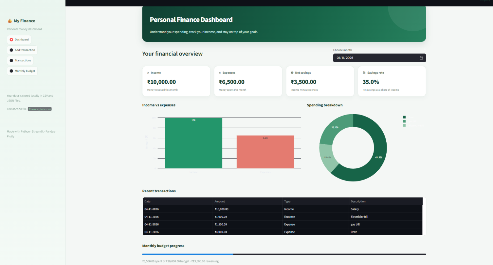
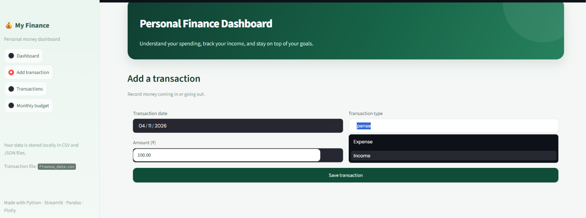
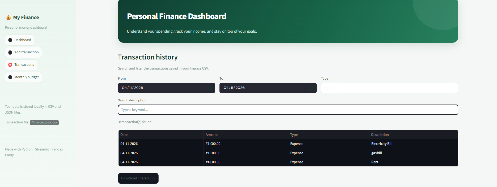
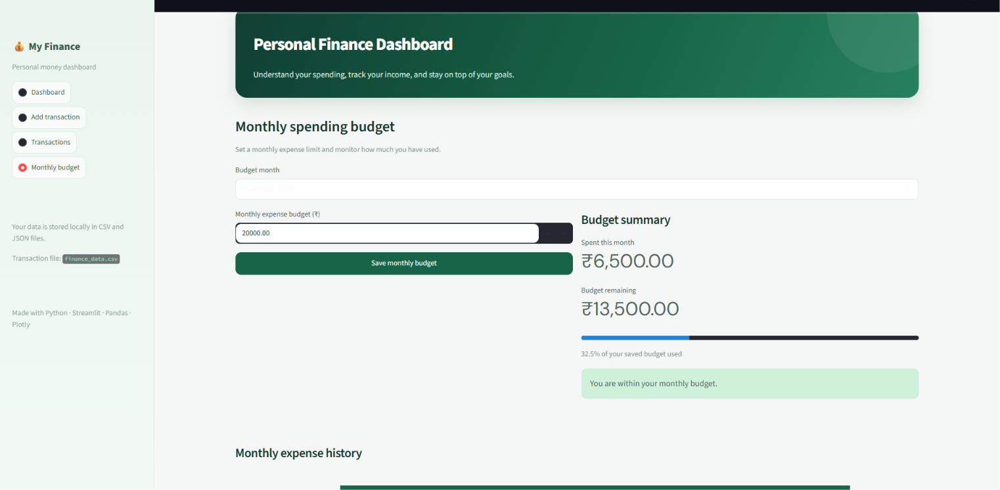

# 💰 Personal Finance Tracker

A simple and modern personal finance management dashboard built with **Python, Streamlit, Pandas, and Plotly**.

Personal Finance Tracker helps you manage your daily finances by recording income and expenses, reviewing monthly financial activity, tracking savings, and monitoring your monthly spending budget.

## 📸 Screenshots

### Dashboard Overview



### Add Transaction


### Transaction History


### Monthly Budget


> **Note:** Add your actual application screenshots to the `screenshots` folder using the filenames shown above.

## ✨ Features

- **Dashboard Overview:** View monthly income, expenses, net savings, and savings rate.
- **Income and Expense Charts:** Compare your monthly income and expenses visually.
- **Expense Breakdown:** View how your expenses are distributed.
- **Add Transactions:** Record income and expenses with a date, amount, transaction type, and description.
- **Transaction History:** Browse, search, and filter saved transactions.
- **CSV Export:** Download filtered transaction records.
- **Monthly Budget:** Set a monthly spending limit and monitor your budget progress.
- **Budget Alerts:** Receive notifications when approaching or exceeding your budget.
- **Expense History:** View monthly expense trends.
- **Local Data Storage:** Store transaction records in CSV format and budget information in JSON format.

## 🛠️ Built With

- [Python](https://www.python.org/)
- [Streamlit](https://streamlit.io/)
- [Pandas](https://pandas.pydata.org/)
- [Plotly](https://plotly.com/python/)

## 📁 Project Structure

```text
Personal Finance Tracker/
│
├── app.py
├── requirements.txt
├── README.md
│
├── screenshots/
│   ├── dashboard.png
│   ├── add-transaction.png
│   ├── transactions.png
│   └── monthly-budget.png
│
├── finance_data.csv
└── monthly_budgets.json
```

**File descriptions:**

- `app.py` – Main Streamlit application.
- `requirements.txt` – Required Python packages.
- `README.md` – Project documentation.
- `screenshots/` – Application screenshots.
- `finance_data.csv` – Stores transaction records.
- `monthly_budgets.json` – Stores monthly budget settings.

The CSV file is created automatically when the application runs if it does not exist. The JSON file is created when a monthly budget is saved.

## ⚙️ Requirements

Before running the application, make sure you have:

- Python installed on your computer.
- pip package manager.
- An internet connection for installing dependencies.

## 📦 Installation

**1. Clone the repository**

```bash
git clone YOUR_GITHUB_REPOSITORY_URL
```

**2. Navigate to the project directory**

```bash
cd "Personal Finance Tracker"
```

**3. Install the required dependencies**

```bash
python -m pip install -r requirements.txt
```

## ▶️ Run the Application

Start the Streamlit application using:

```bash
python -m streamlit run app.py
```

On Windows, if you need to use a specific Python installation, you can run:

```powershell
& "$env:LOCALAPPDATA\Python\pythoncore-3.14-64\python.exe" -m streamlit run app.py
```

After starting the application, Streamlit will display a local URL:

```text
http://localhost:8501
```

Open this URL in your web browser to access the dashboard.

> **Important:** Run the application using Streamlit, not `python app.py`.

## 📖 How to Use

1. Open the application in your web browser.
2. Select a month from the Dashboard to view your financial summary.
3. Navigate to **Add Transaction** to record income or expenses.
4. Visit **Transactions** to search, filter, and export transaction records.
5. Navigate to **Monthly Budget** to set your spending limit.
6. Monitor your expenses and budget progress through the dashboard.

## 💾 Data Storage and Privacy

The application stores financial information locally in the project directory.

- `finance_data.csv` stores income and expense transactions.
- `monthly_budgets.json` stores monthly budget settings.

No database or cloud account is required.

**Privacy recommendations:**
- Keep regular backups of your financial data.
- Do not upload personal financial records to a public GitHub repository.
- Avoid sharing screenshots containing sensitive financial information.

## 💱 Currency and Date Format

- **Currency:** Indian Rupees (₹)
- **Transaction Date Format:** DD-MM-YYYY
- **Storage:** Local CSV and JSON files.

## 🚀 Future Improvements

Possible enhancements for future versions:

- Recurring income and expense transactions.
- Custom expense categories.
- Category-based monthly budgets.
- Edit and delete transactions.
- Custom date-range financial reports.
- Downloadable PDF reports.
- Database integration.
- User authentication and secure access.
- Cloud data backup and synchronization.

## 📄 License

No license has been specified for this project yet.

---

**Developed using Python, Streamlit, Pandas, and Plotly.**

*Making personal finance management simpler and smarter! 💚*